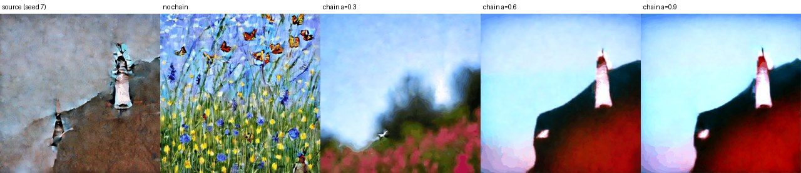

# LoRA support

`examples/generate.py --lora` merges a Stable Diffusion style LoRA into the model before it
goes to the device. The Blackhole runs the ordinary SD UNet with different numbers in it.
Merging costs under a second at load and nothing per frame.

```bash
python examples/generate.py --prompt "storybook anime illustration, a moonlit crypt" \
  --lora "neonforestmist/sd15-storybook-anime-lora:storybook_anime_lora.safetensors@0.85"
```

Add `--lcm-lora` to cut 25 steps to 4 (see [Faster sampling](#faster-sampling-with-the-lcm-lora)).

`--lora SOURCE[:FILE][@SCALE]` can be repeated to stack LoRAs. `SOURCE` is a Hub repo id or a
local path. `FILE` names the `.safetensors` file inside the repo and is required for Hub repos.
`SCALE` defaults to 1.0. Python entry point: `animatediff_ttnn.lora.merge_loras`.

## How it works

The TTNN UNet is built from a CPU `UNet2DConditionModel` by `preprocess_model_parameters`.
`load_sd14_ttnn(device, loras=...)` folds each LoRA into that CPU model first, so
`W' = W + scale * (alpha / rank) * (up @ down)` is baked into the weights the device receives.
The UNet half goes through diffusers' kohya converter. The text-encoder half
(`lora_te_*` keys) is merged by `lora._merge_text_encoder`, because diffusers' own text-encoder
loader finds no matching modules on the transformers 5.x CLIP layout.

## What loads and what does not

| Kind | Loads? | Why |
|---|---|---|
| SD 1.x style LoRA, kohya format (`lora_unet_*`, `lora_te_*`) | Yes | Same layers as the SD 1.4 UNet and CLIP encoder. |
| LoRA for another base model (SDXL, Flux, Krea-2) | No. `merge_loras` raises `ValueError` | Diffusers loads the file but matches no UNet weight. The check for "changed nothing" exists because that outcome otherwise looks like success. |
| `guoyww/animatediff-motion-lora-*` (zoom, pan, tilt, roll) | Not supported | These patch the MotionAdapter's motion modules and do not touch the SD UNet. They need a separate merge into the motion adapter, which this change does not do. |

SD 1.5 LoRAs are applied to SD 1.4 weights, which is this repo's base. The layer shapes are
identical so the merge succeeds, and the three results below look as intended.

## Hardware results (2026-10-07, one Blackhole chip of a P300c pair)

8 frames, 20 steps, 512x512, seed fixed per prompt, `--device-id 0`. Every run in a row
shares prompt and seed with its baseline.

| Run | LoRA tensors merged (UNet + text encoder) | Model load | Denoise, 8 frames |
|---|---|---|---|
| Lighthouse, baseline | none | 8.0 s | 123.7 s (cold kernel compile after a chip reset) |
| Lighthouse, pixel art @1.0 | 192 + 0 | 6.2 s | 19.8 s |
| Lighthouse, storybook anime @1.0 | 192 + 72 | 6.5 s | 18.5 s |
| Crypt, baseline | none | 5.5 s | 18.4 s |
| Crypt, pixel art @1.0 | 192 + 0 | 6.2 s | 18.5 s |
| Crypt, storybook anime @0.85 | 192 + 72 | 6.3 s | 18.2 s |
| Crypt, anime @0.85 + pixel art @0.6 | 384 + 72 | 7.5 s | 18.3 s |

Warm denoise time is 2.3 to 2.5 s per frame with or without a LoRA. The 123.7 s baseline is
the first run after a chip reset and includes kernel compilation; it says nothing about LoRAs.
These are single runs, so differences of a few tenths of a second are within noise.

Observations:

* Pixel art changes the palette and edges strongly even without its trigger phrase.
* Storybook anime at 1.0 without its trigger phrase gives a warm, painterly look. At 0.85 with the
  trigger phrase the crypt becomes an illustrated dungeon with a lit candle. The author recommends 0.75 to 0.95.
* Stacking works. The stacked crypt differs from both single-LoRA crypts: it keeps the anime
  lighting and picks up the pixel-art LoRA's blocky floor and water.
* The figures in the prompts ("a pale figure waving", "a hooded figure holding a lantern") do not
  appear in any run, with or without a LoRA. SD 1.4 does not render them reliably; LoRAs do not fix that.

### Lighthouse: baseline, pixel art, storybook anime (top to bottom)

Prompt: *a candlelit abandoned lighthouse on black cliffs, thick fog creeping over the sea, a
pale figure waving from the highest window, eerie, mysterious, midnight*. Seed 1313.


### Crypt: baseline, pixel art, storybook anime, both stacked (top to bottom)

Prompt: *a moonlit crypt beneath a drowned chapel, a hooded figure holding a single lantern,
whispering shadows gathering along the walls, ghostly mist, ancient runes glowing faintly,
haunting, mysterious*, with each LoRA's trigger phrase in front ("Pixel Art, ",
"storybook anime illustration, "). Seed 666.


Each image shows frames 1, 4 and 8 of the 8-frame GIF. With the default Phase 2.5 path the
frames differ little from each other.

## Checked before anything loads

`inspect_lora()` reads only the safetensors header, so it costs milliseconds and needs no device. The
CLI runs it before claiming a chip and `merge_loras` runs it before loading a model. It refuses, with the
reason, an SDXL LoRA (two text encoders, or SDXL metadata), a LoHa or LoKr file, a DoRA file, and anything
without kohya `lora_down` / `lora_up` tensors (diffusers-format and motion LoRAs). It also prints the most
common training tags from the file's `ss_tag_frequency` metadata. These are hints for a trigger phrase and
are not required; many LoRAs have none. On the files used here it reported 192 UNet and 72 text-encoder
modules for storybook anime, which matches what the merge changed, and listed `storybook anime illustration`,
the trigger phrase from the author's card.

## Does the merged LoRA survive the trip to the device?

The pictures above show a LoRA changes the output. They do not show the device computes what the CPU would
with the same merge, and the device weights are bfloat16 while a LoRA delta is small.
`scripts/lora_device_check.py` runs one UNet step (same latent, timestep 500, same text embedding) on the
CPU and on one Blackhole chip, with and without the LoRA, and compares the **effect** of the LoRA
(`with - without`) on each. The first two columns can look good even if the LoRA did nothing on the device,
because the LoRA is a small change to a large signal. The last column cannot.

| LoRA | Effect / signal (CPU) | PCC device vs CPU, no LoRA | PCC device vs CPU, with LoRA | PCC of the effect |
|---|---|---|---|---|
| Pixel art @1.0 | 0.100 | 0.9994 | 0.9995 | 0.935 |
| Storybook anime @0.85, UNet half | 0.028 | 0.9994 | 0.9995 | 0.690 |
| LCM-LoRA @1.0 (LoCon, conv targets) | 0.232 | 0.9994 | 0.9888 | 0.864 |

The effects reach the device in every case. A small effect is partly buried in bfloat16 noise: the storybook
LoRA changes the output by 2.8% of its norm and the device reproduces that change with correlation 0.69.
The LCM-LoRA changes convolution weights as well as attention, and those survive (0.86), but the overall
device-to-CPU match drops from 0.9994 to 0.9888. One seed and one timestep each, so these show that the
effect arrives. They do not measure what it costs in quality.

## Faster sampling with the LCM-LoRA

`latent-consistency/lcm-lora-sdv1-5` is a LoRA that turns the UNet into a consistency model. Merged next to
a style LoRA (the deltas add) and paired with `LCMScheduler`, it needs about 4 steps at guidance 1.5 instead
of 25 steps at 7.5. It is a rank-64 LoCon with 278 targets, including 3x3 and 1x1 convolutions and
`time_emb_proj`, so it exercises more of the merge than the two style LoRAs. Checked three ways:

* On the CPU, all 278 tensors change, and a 3x3 conv, a 1x1 conv and a linear target match
  `W + alpha/rank * up @ down` to about 1e-8.
* On the chip, the numeric check above.
* End to end, images and times below. 8 frames, seed 666, one chip.

| Run | Denoise, 8 frames | Per frame |
|---|---|---|
| Pixel art, 20 steps, guidance 7.5 | 18.6 s | 2.3 s |
| Pixel art + LCM, 4 steps, guidance 1.5 | 9.2 s | 1.2 s |
| Pixel art + LCM, 8 steps | 11.3 s | 1.4 s |
| LCM only, 4 steps | 9.2 s | 1.2 s |

End to end that is about 2x. The UNet work falls by 5x, and the remainder (VAE decode, the CPU
temporal blend, the first-call kernel load) does not shrink. Served warm, the same 4-step variant took 4.2 s
for 8 frames against 21.6 s at 25 steps.


The compositions differ from the 20-step result, as they do for any change of sampler. The LCM-only panel has
grid lines. They do not depend on `--temporal-alpha` (alpha 0 looks the same) and get stronger at 8 steps. With
a prompt that does not contain "Pixel Art" the 4-step output has no lines (below), so the lines come from the
prompt, which asks the base model for a pixel grid, and not from LCM or the device.


Fewer steps also means less cross-frame blending. Over the served runs, the first and last frames of a
clip differed by 43.9 (mean absolute pixel difference) with LCM at 4 steps and 19.4 with the 25-step style
variant, so LCM clips are less coherent from frame to frame. Try 8 steps, and compare against the
25-step result, before using it for a clip that has to loop. `--lcm-lora` cannot be combined with
`--lightning` or `--motion-adapter`.

## Serving LoRAs

The served path (`animatediff_ttnn.server.app`, which `tt-model serve` runs) takes a **catalog** of named
variants from the operator. Each is a full model set resident on the chip, so choosing one per request
costs nothing.

```bash
ANIMATEDIFF_LORAS='{
  "pixel":      "artificialguybr/pixelartredmond-1-5v-pixel-art-loras-for-sd-1-5:PixelArtRedmond15V-PixelArt-PIXARFK.safetensors",
  "pixel-fast": ["artificialguybr/pixelartredmond-1-5v-pixel-art-loras-for-sd-1-5:PixelArtRedmond15V-PixelArt-PIXARFK.safetensors",
                 "latent-consistency/lcm-lora-sdv1-5:pytorch_lora_weights.safetensors"]
}' python -m uvicorn --lifespan on animatediff_ttnn.server.app:app
curl -s localhost:8000/v1/videos/generations -H 'content-type: application/json' \
  -d '{"prompt": "a moonlit crypt", "lora": "pixel-fast", "num_frames": 8}'
```

* A value is one spec string or a list (stacked). Names are letters, digits, `.`, `_`, `-`; `base` is refused.
* `GET /v1/models` lists the names under `loras`. An unknown name is a 400 that lists the valid ones, and is
  refused before the device lock, so it never waits behind a generation.
* A request names a variant and never a repo id or a path. The operator decides which files the server loads.
* A variant that includes the LCM-LoRA samples with LCM and defaults to 4 steps and guidance 1.5 when the
  request leaves them out. Values the caller sends are used as sent.
* Variants share the plain model's VAE. Each costs one UNet's weights on the device, plus about 7 s at startup.
  Switching between the plain model and two variants, then back, reproduced the plain model's frames exactly.
* A bad catalog or an incompatible file fails startup, before readiness, and the chip is released.
* `prompt_schedule` (a list of `{"frame": n, "prompt": "..."}`) is accepted too and encoded with the chosen
  variant's text encoder. With keyframes at frames 0 and 7 the first and last frames differed by 82.7 against
  43.9 without a schedule.

`tt-model serve` has no `--env` option. It forwards only `HF_TOKEN` from the host, so the catalog goes in the
package's manifest instead, as `serve.env` or in a serve profile. A profile lets one image offer a plain launch and
a launch with the catalog:

```yaml
serve_profiles:
  - name: plain
  - name: loras
    env:
      ANIMATEDIFF_LORAS: '{"pixel": "artificialguybr/pixelartredmond-1-5v-pixel-art-loras-for-sd-1-5:PixelArtRedmond15V-PixelArt-PIXARFK.safetensors"}'
      ANIMATEDIFF_MOTION_ADAPTER: default
default_profile: loras
```

and the consumer picks one with `tt-model serve episod/tt-animatediff --profile loras`. A different catalog means a
repackage, because the values are part of the published manifest. The image needs `peft`, which this release adds to
`tt_model_package.yaml` and its lock (checked in a built image: `peft`, `animatediff_ttnn.lora` and the server module
all import). `extra_code.ref` must point at a tag that contains this code. LoRA files are fetched from the Hub at
startup, so a container without network access needs them in its Hugging Face cache first.


## Watching a served generation

`GET /v1/videos/preview` returns `{"step": n, "total": N, "gif_b64": "<base64 GIF>" | null, "running": bool}`
for the generation in flight. It never waits on the device lock: a test holds the lock inside a blocked
generation and reads the endpoint. It answers 200 with zeros before the model is ready, so a poller does not
have to tell "starting" from "idle". `step` is 1-based and `total` is the loop's real step count (a 20-step
request reports 21, because the default sampler runs 21 timesteps).

The step counter always runs. The GIF is rendered only when the request sets `"preview": true`; it is
256x256, rewritten atomically each time it renders, and reset at the start of each request. After a run ends
the last frame stays readable until the next request begins. `"preview_every": n` renders every nth step; the
default is every step up to 10 steps and every other step beyond that.

Rendering costs generation time. On one chip, 8 frames and 20 steps took 13.5 to 13.9 s with no preview and 17.8
to 20.2 s with previews (about 0.4 s per render, 11 renders). Poll latency during a run was about 140 ms. Ask for
previews only when someone is looking, and raise `preview_every` if the cost matters.

Every `uvicorn` run here ended with `terminate called after throwing an instance of UmdException` after
"Application shutdown complete". It happens on a plain server with no preview and no LoRA activity at exit, so it
is a tt-metal teardown abort and not caused by these features; the process exit code is non-zero.

## Other served features

These are the features `examples/generate.py` already had, now in the served request too.

**Sampler (`"sampler": "euler"`).** The plain model samples with PNDM by default. `euler` is what the CLI calls
`--lightning`: the base UNet with an Euler schedule and no distilled weights. 4 frames at 25 steps took 7.7 s with
Euler and 7.9 s with PNDM, and the two outputs differ (mean absolute pixel difference 42.7). An LCM variant always
samples with LCM, so naming a sampler with one is a 400.

**Chaining (`"chain_save": "name"`, `"chain_from": "name"`, `"chain_alpha": 0.6`).** A run saves its final latents under
a name. A later request blends their frame mean into its starting noise, so a new prompt inherits the old
composition. Names, never paths: the server keeps the files in its own directory under a hash of the name, keeps at
most 32 (oldest dropped), and forgets them all when it stops. An unknown `chain_from` is a 400.
In the picture below, a lighthouse run is chained into a meadow prompt at a different seed. At 0.6 and 0.9 the tower
and cliff carry over, and the meadow prompt is mostly lost (no flowers or butterflies), which matches the library's
advice to stay at or below about 0.55. At 0.3 the effect is small. A pixel difference to the source did not show
this (colour dominates it), so judge by eye.



**MotionAdapter temporal attention (`"motion_adapter": true`).** Phase 3. It is off unless the operator sets
`ANIMATEDIFF_MOTION_ADAPTER=default` (or a repo id or local path) in the package's `serve.env` or a serve profile, which loads the adapter at startup. Without that,
a request for it is a 400. `GET /v1/models` reports `"motion_adapter": true|false`. `motion_adapter_alpha` (0 to 1,
default 1) and `motion_adapter_skip` (any of `down0 down1 down2 mid up0 up1 up2`) match the CLI flags. It works with
the Euler sampler, prompt schedules, chaining and style LoRA variants. It cannot be combined with an LCM variant,
because the Phase 3 loop has no LCM sampler. Measured on one chip with `up1` and `up2` skipped, 2 frames at 6 steps took
5.6 s (3.2 s at alpha 0, which bypasses the injection). Without skipping, it is much slower: the earlier measurement
on a four-chip box was about 52 s per frame at 25 steps, so an 8-frame request runs for several minutes. Set client
timeouts accordingly.

## Every served mode, timed (2026-10-14, container image)

Measured through the container image that `tt-model package --container` built from commit `fb9ef60`, on one
chip of a P300c pair. `tt-model serve` cannot serve a package directory that has not been pushed (`pull` and
`serve` take a Hub repo id only), so the container was started with the `docker run` that `tt-model serve --print`
composes for this package, plus the `full` serve profile's environment (the LoRA catalog and
`ANIMATEDIFF_MOTION_ADAPTER=default`). Pushing to `episod/tt-animatediff` to test would have replaced the live repo.
`scripts/benchmark_modes.py` drove it: 8 frames at 512x512, seed 42, the same prompt for every row, median of 3
after one warm-up request. The first request of the process took 119.6 s, because it compiles kernels.

| Mode | Seconds | Against |
| --- | --- | --- |
| plain, 25 steps | 15.3 | |
| plain, 20 steps | 12.8 | |
| plain, 12 steps | 8.7 | about 0.5 s per step plus 2.4 s fixed |
| `temporal_alpha` 0 | 15.2 | same as 25 steps: the blend costs nothing measurable |
| `sampler: euler`, 25 steps | 15.0 | 15.3 with PNDM |
| `prompt_schedule` (frames 0 and 7) | 15.5 | +0.2 |
| `preview: true`, 20 steps | 17.7 | +4.9 over 12.8 |
| `chain_from`, 20 steps | 12.9 | +0.1 over 12.8 (the `chain_save` run is not timed) |
| `lora: pixel`, 25 steps | 15.8 | +0.5 over 15.3 |
| `lora: lcm` (4 steps, guidance 1.5) | 4.1 | 3.7x faster than plain 25 |
| `lora: pixel-fast` (style + LCM, 4 steps) | 4.3 | 3.6x faster than plain 25; 3.7x faster than `pixel` |

The first request to each LoRA variant took 1.3 to 1.5 s longer than the next two (5.6 against 4.1 for `lcm`,
17.6 against 15.8 for `pixel`), so a service that switches variants pays that once per variant.

**Motion adapter (Phase 3), 2 frames, 6 steps.** The adapter's cost is the CPU round-trip at its injection
points, so it depends on which points run and not on the alpha:

| Setting | Seconds (3 runs) |
| --- | --- |
| no skip, alpha 1 | 23.6, 24.2, 25.3 |
| no skip, alpha 0 | 25.4, 25.9, 27.8 |
| `motion_adapter_skip: [up1, up2]`, alpha 1 | 3.7, 3.4, 3.4 |
| `motion_adapter_skip: [up1, up2]`, alpha 0 | 3.2, 3.3, 3.2 |

Alpha 0 saves nothing, because the staged UNet and its round-trips still run. The two skipped blocks are the
high-resolution ones and account for about 20 of the 24 seconds. The alpha 1 and alpha 0 frames differ (mean pixel
difference about 44), so the adapter does change the output at the remaining points. The 5.6 s I recorded for the
skipped run on 2026-10-13 was a first request; the same setting settles at 3.4 s.

## Which LoRAs to try next

Tried so far: two style LoRAs (pixel art, storybook anime), their stack, and the LCM-LoRA. Not tried, and
what each would show:

* **A character or concept LoRA with a trigger token.** Tests the text-encoder half and the trigger-word hint
  against a LoRA that does nothing without its token.
* **A detail slider LoRA used at negative and large scales** (the "add detail" family). The scale parser
  accepts signs, and nobody has checked that a negative scale behaves on the device.
* **A third LoRA stacked on a style plus LCM.** The CPU merge of anime, pixel art and LCM works with no leftover
  adapter layers on the container's versions; the device result and the quality of the stack are untried.
* **A SD 1.5 base.** Most LoRAs are trained on 1.5 and this repo serves 1.4. Same architecture, but a style may
  match better on 1.5.
* **LyCORIS LoHa / LoKr** files are refused with a clear message. Supporting them would mean a separate merge.
* **Motion LoRAs** (zoom, pan, roll) patch the motion adapter and need the Phase 3 path, which does not run an LCM
  sampler and is much slower.

Sources for candidate files (checked only as listings, not downloaded): the
[detail and noise-offset files](https://huggingface.co/ffxvs/lora-effects/tree/main) appear on third-party
mirrors, so check the author and license before use.

## Limits and caveats

* **Phase 3 and CPU modes.** `--lora` and `--lcm-lora` work in blackhole and sim modes with the default
  (Phase 2.5) loop. The served path takes LoRAs through the catalog above. `--mode cpu`, `--motion-adapter`
  and `session.ensure_blackhole` do not.
* **Not pinned.** A LoRA repo you name is downloaded at its default branch (`revision_for` returns
  `None` for repos this package does not pin). Only `.safetensors` files are read.
* **Merged weights are not cached.** Each run re-merges. At under a second this does not need a cache.
* **Validated on diffusers 0.39 and peft 0.21.** `requirements.txt` still allows diffusers 0.32.1;
  the merge uses `unet.fuse_lora` and `unet.unload_lora`, which were not tried there.
* **Licenses.** The pixel art LoRA is `license:other`, the anime LoRA is CreativeML OpenRAIL-M, and the
  Krea-2 LoRA (which does not load) is `license:other`. Check each before redistributing output.

## Reproduce

```bash
gozer run --chips 1 --who "claude:lora" --reason "lora demo" -- \
  python examples/generate.py --device-id 0 --frames 8 --steps 20 --seed 666 \
  --prompt "Pixel Art, a moonlit crypt beneath a drowned chapel, ghostly mist, haunting" \
  --lora "artificialguybr/pixelartredmond-1-5v-pixel-art-loras-for-sd-1-5:PixelArtRedmond15V-PixelArt-PIXARFK.safetensors"
```

Open one device per process. Launching three at once failed in firmware init
(`risc_firmware_initializer`) and left the chips needing a reset.
